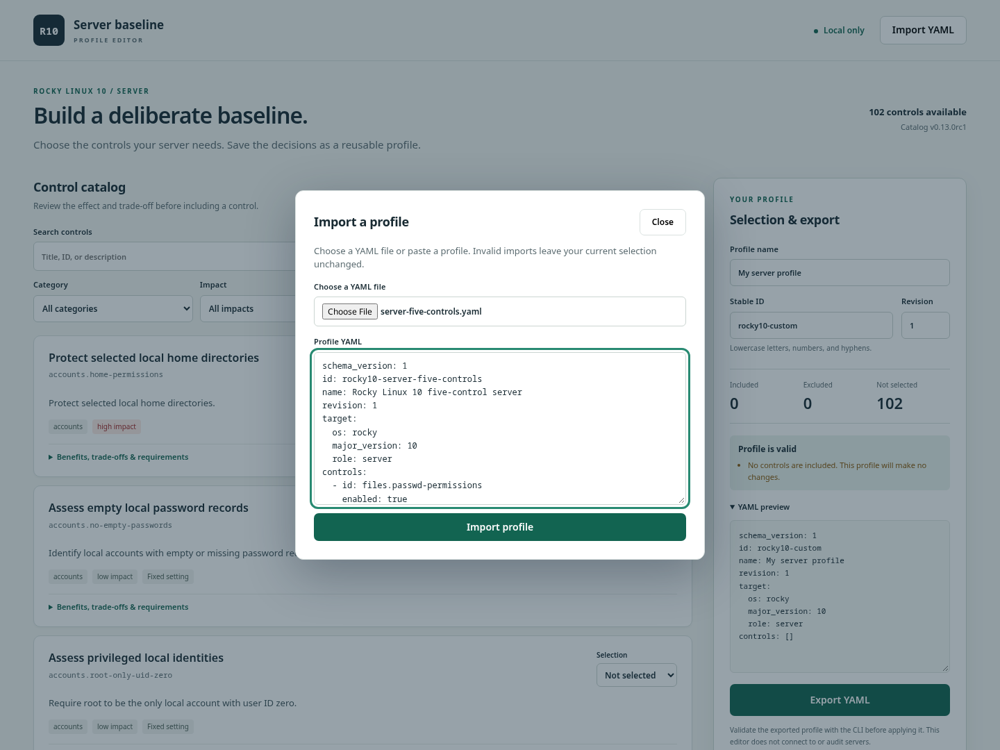
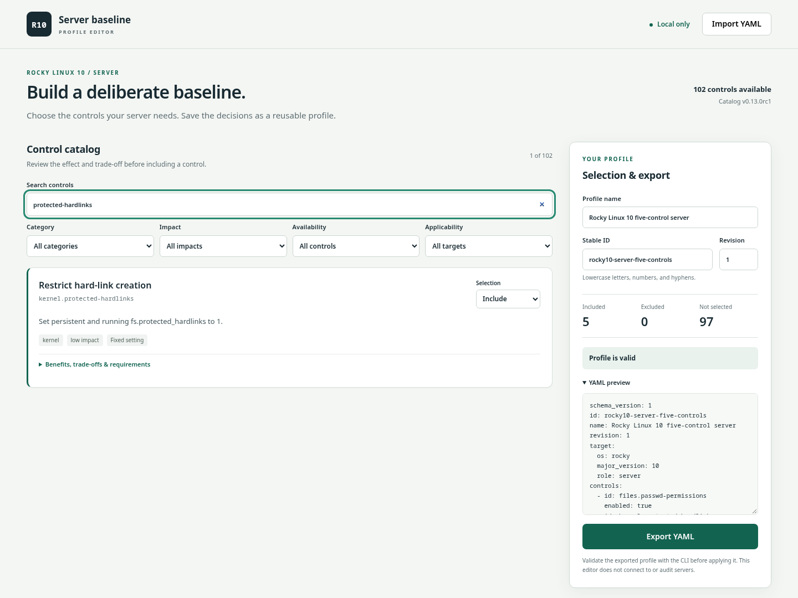

# Rocky Linux 10 OS baseline

A profile-driven hardening CLI for **Rocky Linux 10 and RHEL 10 server guests**, with an
optional offline profile editor. Select controls, audit a server, apply an approved
profile, and independently verify the resulting state.

The catalog contains **102 controls: 90 remediations and 12 read-only assessments**.
It covers local accounts, file permissions, kernel settings, packages, services,
SSH, sudo, networking, firewall, logging, SELinux, audit, integrity, storage,
boot, and cryptographic policy. See the [control coverage](docs/control-coverage.md).

**Status:** release candidate. The [v0.13.0rc1 release record](docs/m13-release-readiness.md)
describes the accepted test matrix and known limitations. This README follows `main`,
including subsequent fixes. The project has **no license grant** and makes no
certification claim.

[Requirements](#requirements) · [Quick start](#quick-start) ·
[Profile editor](#offline-profile-editor) · [Profiles](#profile-format-and-selection) ·
[Reports](#reports-and-exit-codes) · [Troubleshooting](#troubleshooting) ·
[Tests](#development-and-tests) · [Documentation](#documentation-and-support)

## Requirements

| Component | Role and requirements |
| --- | --- |
| Controller | Runs the CLI and Ansible. Tested on a separate Rocky Linux 10.2 x86_64 development guest with Python 3.12. The pinned dependencies install Ansible Core 2.19.15. |
| Managed target | A Rocky Linux 10 or RHEL 10 **server guest** on KVM or EC2 Xen, reachable over SSH, with DNF, a `multi-user.target` default boot target, and working root privilege escalation. Acceptance testing used Rocky 10.2 x86_64. |
| Recovery | A disposable target and an independently tested snapshot/restore route. High-impact preflight and apply additionally require an authenticated recovery receipt. |
| Optional editor build | Node.js 22 and the project's Python environment. The generated HTML opens directly in a modern browser. |

Run the commands below in Bash **inside the controller guest**, from the repository
root unless a step says otherwise. The controller connects to the target over SSH.
The framework does not create guests or manage the hypervisor.

Preflight requires the profile's distribution, major version 10, and a guest
running on KVM or EC2 Xen. EC2 Xen identity is checked through the hypervisor UUID.
Bare metal, containers, other Xen platforms, and mismatched profiles are refused.
Ubuntu CI checks portable code, not target behavior. Native RHEL and Rocky EC2
validation and its limits are recorded in [the platform report](docs/dual-os-validation.md). UEFI, directory-backed identities, and FIPS deployments are outside the
established acceptance matrix. Review [operations](docs/operations.md) before
extending the lab configuration.

## Quick start

### 1. Install the controller

```bash
sudo dnf install -y git python3-pip
git clone --branch main https://github.com/don-milsey-miller/rocky10_os_baseline.git
cd rocky10_os_baseline
git rev-parse HEAD
python3 --version
python3 -m venv .venv
source .venv/bin/activate
python -m pip install -r requirements-tested.txt
python -m pip install --no-build-isolation -e '.[test]'
hardener --help
```

Use Python 3.12 or newer. Record the commit printed by `git rev-parse HEAD` with
your test results. To reproduce the accepted release candidate instead of current
`main`, clone with `--branch v0.13.0rc1` and follow that version's documentation.
For subsequent terminal sessions, return to this directory and run
`source .venv/bin/activate`.

### 2. Validate the starter profile

Start with five low-impact controls: `/etc/passwd` permissions, protected hard
links, disabled debug shell, absent Telnet client, and local package signature
checking. Read the [control behavior](docs/m2-controls.md) before applying them.

```bash
PROFILE=profiles/examples/server-five-controls.yaml
hardener validate --profile "$PROFILE"
```

Expected output:

```text
Valid profile: rocky10-server-five-controls revision 1
```

Validation is local. It checks the profile against the catalog and schema without
contacting a target or changing its state.

### 3. Configure one disposable target

Create a recoverable snapshot and verify that you can restore it independently of
target SSH. Then copy the inventory template:

```bash
cp inventory.example.ini inventory.local.ini
```

Edit `inventory.local.ini`, replacing both placeholder values:

```ini
[lab]
test-vm ansible_host=REPLACE_WITH_GUEST_ADDRESS ansible_user=REPLACE_WITH_SSH_USER hardener_role=server
```

Configure SSH key authentication for that user and verify the target's host-key
fingerprint through a trusted console before accepting it into `known_hosts`.
The CLI enforces host-key checking. The disposable lab uses passwordless sudo.
Keep credentials in SSH/Ansible facilities, outside profiles and Git. Inventory
and Ansible plugins are trusted operator configuration.

Check connectivity and privilege escalation:

```bash
ansible -i inventory.local.ini test-vm -m ansible.builtin.ping
ansible -i inventory.local.ini test-vm --become -m ansible.builtin.command -a 'id -u'
```

The second command must return `0`. `--target test-vm` below selects this exact
inventory alias. Host patterns and `all` are refused.

### 4. Run preflight and audit

Use a new evidence directory for each run. Keep `PROFILE` and `RUN` set in the
same shell for the remaining steps.

```bash
RUN="reports/$(date -u +%Y%m%dT%H%M%SZ)"
hardener preflight --profile "$PROFILE" --inventory inventory.local.ini \
  --target test-vm --output "$RUN/preflight"
cat "$RUN/preflight/summary.txt"
```

Proceed only after preflight succeeds. It checks access, platform, server role,
and selected prerequisites. It does **not** assess whether controls pass.

```bash
hardener audit --profile "$PROFILE" --inventory inventory.local.ini \
  --target test-vm --output "$RUN/before"
cat "$RUN/before/summary.txt"
```

Audit exit code `5` means one or more controls did not meet the requested state.
Review the findings and expected changes before proceeding. Audit and verification
do not remediate managed state, although SSH logs and temporary execution files
can still be created.

### 5. Apply, verify, and check repeatability

**Apply changes the target.** Use the disposable guest whose snapshot and access
you checked above. Run each command separately and inspect its result before the
next one.

```bash
hardener apply --profile "$PROFILE" --inventory inventory.local.ini \
  --target test-vm --output "$RUN/apply"
cat "$RUN/apply/summary.txt"
```

Apply performs preflight, remediates explicitly enabled controls, and independently
verifies their resulting state. A successful Ansible task alone is insufficient.
You can also verify separately, including after an operator-managed reboot:

```bash
hardener verify --profile "$PROFILE" --inventory inventory.local.ini \
  --target test-vm --output "$RUN/after"
cat "$RUN/after/summary.txt"
```

Repeat apply to check idempotence:

```bash
hardener apply --profile "$PROFILE" --inventory inventory.local.ini \
  --target test-vm --output "$RUN/second-apply"
cat "$RUN/second-apply/summary.txt"
```

For an unchanged target and this starter profile, expect all five controls to
pass and the second apply to report `changed_tasks=0`. Retain the reports, exact
profile, inventory securely, and source commit with your evidence.

### High-impact profiles require recovery evidence

Before selecting access, firewall, identity, or other high-impact changes, follow
the complete [recovery rehearsal](docs/recovery-enforcement.md). The rehearsal
intentionally exercises administrative SSH loss and restoration from a known
snapshot. It requires an independent hypervisor session and explicit operator
actions. The framework does not stop SSH or restore the snapshot for you.

Only after preparing that procedure, start the observer on the controller:

```bash
hardener recovery-test --inventory inventory.local.ini --target test-vm \
  --output "$RUN/recovery"
```

A successful rehearsal produces `recovery.json`. Supply it to both high-impact
preflight and apply. For example, after reviewing and adapting the network lab
profile to your disposable target:

```bash
hardener preflight --profile profiles/examples/server-network-host-lab.yaml \
  --inventory inventory.local.ini --target test-vm \
  --recovery-evidence "$RUN/recovery/recovery.json" --output "$RUN/network-preflight"
hardener apply --profile profiles/examples/server-network-host-lab.yaml \
  --inventory inventory.local.ini --target test-vm \
  --recovery-evidence "$RUN/recovery/recovery.json" --output "$RUN/network-apply"
```

Receipts expire after 24 hours and bind the inventory, target identity, engine,
and controller key. Changes to those bindings require another rehearsal. Audit
and verify do not require a receipt. Keep the controller key and runtime evidence
out of Git. There is no force bypass or automatic rollback.

## Offline profile editor

The editor lets you inspect controls and create YAML profiles locally. It does
not connect to servers, run audits, or apply changes.

### Build and open

With the Python environment from the quick start installed:

```bash
sudo dnf install -y nodejs nodejs-npm
node --version
cd web
npm ci --ignore-scripts
npm run build
cd ..
```

Use Node.js 22. Open `web/dist/index.html` directly in your browser. If the
controller has no desktop, copy this single file to your computer and open it
there. The generated file includes its catalog, validation, styles, and dependency
notices. No web server, account, or network connection is required at runtime.

### Import, review, and export

1. Select **Import YAML**, choose `profiles/examples/server-five-controls.yaml`
   (copy it to your browser's computer if necessary), and select **Import profile**.
2. Search or filter controls. Expand **Benefits, trade-offs & requirements** and
   inspect parameters before selecting **Include**, **Exclude**, or **Not selected**.
3. Set the profile name, stable ID, and revision. Resolve validation errors and
   review warnings.
4. Select **Export YAML** before closing or reloading. Drafts live in memory.
5. Copy the exported file to the controller, set `PROFILE` to its path, and
   validate the exact file before using the CLI workflow:

```bash
# Replace this example path with the exported file's location on the controller.
PROFILE="$HOME/Downloads/rocky10-server-five-controls.yaml"
hardener validate --profile "$PROFILE"
```

Importing the starter profile in the actual editor:



After import, filtering to `protected-hardlinks` shows one of the five included
controls. The preview and **Export YAML** action remain visible:



These screenshots were captured from the built editor at 1440 × 1080 using the
shipped starter profile. The exported download was validated with the CLI.
See the [editor guide](web/README.md) for build details and import constraints.

## Profile format and selection

Choose **Target distribution** in the offline editor, or set target.os to
rocky or rhel in YAML. This does not translate repository IDs, signing keys,
time servers, or account names. Review those parameters for the actual server.
Start with [the RHEL example](profiles/examples/rhel10-server-minimal.yaml) or
[the Rocky example](profiles/examples/server-minimal.yaml). Selections survive
distribution changes. Export and import preserve the chosen distribution.

RHEL support currently has bounded EC2 acceptance. See the
[validation report](docs/dual-os-validation.md) before using high-impact controls.
Existing managed filenames containing rocky10 remain shared engine paths to
avoid duplicate configuration or breaking existing Rocky deployments.


Profiles are data. They contain identifiers and approved parameters, never shell
commands, task paths, or credentials. For example:

```yaml
schema_version: 1
id: rocky10-example
name: Example server profile
revision: 1
target:
  os: rocky
  major_version: 10
  role: server
controls:
  - id: files.passwd-permissions
    enabled: true
  - id: kernel.protected-hardlinks
    enabled: false
    reason: Reviewed separately for this example
```

`enabled: true` selects a control. `enabled: false` records an explicit exclusion.
Omitted controls are not run. Dependencies must be explicitly included, and
conflicting selections are rejected. Assessment-only controls support audit and
verify but cannot be enabled in an apply profile. Keep those assessments in a
separate profile when applying remediations.

| Starting point | Intended use |
| --- | --- |
| [Five controls](profiles/examples/server-five-controls.yaml) | First disposable-target walkthrough. |
| [General server](profiles/examples/server-general.yaml) | Broader starting point for review, not a universal production policy. |
| [Account assessments](profiles/examples/server-account-assessment.yaml) | Read-only identity findings. |
| [Storage review](profiles/examples/server-storage-review.yaml) | Read-only filesystem, storage, and boot findings. |
| [All example profiles](profiles/examples) | Domain-specific lab examples. Inspect required fixtures, dependencies, and site-specific parameters before use. |

See [profile format](docs/profile-format.md) for schema and parameter rules.
Unknown IDs, duplicate keys, unsafe YAML constructs, and invalid parameters fail
validation. The input limit is 64 KiB and 128 control entries.

## Reports and exit codes

Remote control operations write `summary.txt` and `report.json` to `--output`.
Reusing an output directory replaces those files. Local validation prints its
result without creating a target report. Recovery-test has its own receipt and
evidence contract described in the recovery guide.

The JSON report records the target alias, profile ID/revision/hash, engine
version/hash, preflight result, changed-task count, per-control evidence, and
errors. Inspect `status`, `observed`, `expected`, `reason`, `changed`, and
`reboot_required` for each control.

| Status | Interpretation |
| --- | --- |
| `pass` | Observed state meets the selected control. |
| `fail` | Observed state does not meet the selected control. |
| `not_applicable` | The control does not apply to this target state. |
| `excluded` | The profile explicitly disabled the control. |
| `unsupported` | The requested state is unsupported in this context. |
| `skipped` | The control did not run, such as after a prerequisite failure. Successful preflight also marks controls skipped because it does not assess them. |
| `error` | Execution or required evidence failed. |

| Exit code | Meaning and next step |
| --- | --- |
| `0` | Operation succeeded. Inspect applicability and exclusions before making a broader conclusion. |
| `2` | Invalid arguments, profile, catalog, or inventory. Correct the input. |
| `3` | Preflight or recovery refused/failed. Resolve the reported prerequisite. |
| `4` | Execution, reporting, or local file failure. Inspect errors and target state. |
| `5` | Unmet, unsupported, or skipped control state in audit, apply verification, or verify. Review each affected control. |

A failed apply can leave partial changes. `changed: null` means change state is
unknown. Failed prerequisites skip dependent controls, while independent controls
may proceed. Preserve evidence, inspect the target through your recovery route,
and restore the known snapshot when needed. The framework does not automatically
roll back failed runs or reboot a target.

## Troubleshooting

| Symptom | Check |
| --- | --- |
| SSH or escalation failure | Verify the inventory address/user, trusted host key, key authentication, and the two Ansible connectivity commands above. |
| Unsupported target | Confirm the selected Rocky 10 or RHEL 10 distribution, KVM or EC2 Xen guest identity, `hardener_role=server`, DNF, and `systemctl get-default` reporting `multi-user.target`. |
| Recovery evidence refused | Inspect the reason. Rehearse again for expired receipts or changed inventory, target, engine, or controller. See [recovery diagnostics](docs/recovery-enforcement.md). |
| Profile rejected | Run local validation. Check explicit dependencies, parameter types, duplicate IDs, and assessment-only controls in apply profiles. |
| Unexpected verification failure | Inspect per-control evidence and configuration conflicts. Honor `reboot_required` and verify again after an approved reboot. |
| Browser tests refused for memory | On Linux, the suite requires at least 2 GiB of **available RAM plus free swap**. Check `free -m`. See [browser-test resources](web/README.md#browser-test-resources). |

## Development and tests

Run local checks from the controller with `.venv` active:

```bash
pytest -q
ruff check hardener tests web/prepare.py
ruff format --check hardener tests web/prepare.py
ansible-playbook -i inventory.example.ini hardener/data/ansible/run.yml \
  --syntax-check -e hardener_target=test-vm
ansible-playbook -i inventory.example.ini hardener/data/ansible/recovery.yml \
  --syntax-check -e hardener_target=test-vm
```

The optional editor tests need Node.js 22, the
[Rocky Chromium libraries](web/README.md#browser-test-resources), and sufficient
available memory. They test the application, not managed-target hardening:

```bash
cd web
npm ci --ignore-scripts
npm run build
npm test
npx playwright install chromium --only-shell
npm run test:browser
cd ..
```

On a disposable 1 GiB browser-test VM, provision 2 GiB swap before the suite or
use a larger runner. The preflight only reads resources. It does not configure
swap. This test requirement does not change the built editor's behavior or target
support. See the [resource validation record](docs/issue5-browser-resources.md).

After building the editor, check packaging and an independently installed wheel.
Start with an empty `dist/` directory by moving earlier build artifacts elsewhere.
The smoke and release checks require exactly one wheel and one source archive:

```bash
python -m build --no-isolation
python tests/integration/package_smoke.py
python tests/release_checks.py
```

Tests that change a target require a disposable guest, prepared fixtures,
snapshot recovery, and any applicable recovery receipt. Follow the
[five-control integration instructions](docs/m2-testing.md) or the
[full release reproduction](docs/m13-release-readiness.md). Do not point those
integration suites at a production server. The [CI workflow](.github/workflows/ci.yml)
runs portable checks and packaging on Ubuntu. Rocky KVM target acceptance is
recorded separately in the release evidence.

## Documentation and support

| Document | Use it for |
| --- | --- |
| [Coverage](docs/control-coverage.md) | Available controls and scope. |
| [Profile format](docs/profile-format.md) | Selection, validation, and parameters. |
| [Operations](docs/operations.md) | Lab setup, inventory, snapshots, and execution. |
| [Recovery](docs/recovery-enforcement.md) | Required rehearsal and refusal diagnostics. |
| [Architecture](docs/architecture.md) | Engine design and control authoring. |
| [Release readiness](docs/m13-release-readiness.md) | Acceptance matrix, reproduction, and limitations. |

Report bugs through [GitHub issues](https://github.com/don-milsey-miller/rocky10_os_baseline/issues).
Include the commit/version, controller and target OS, mode, exit code, reproduction
steps, and sanitized error details. Do not publish credentials, recovery keys, or
private inventory/report data.

No project license has been granted. Bundled dependencies retain their own
licenses. The editor embeds their notices and emits `web/dist/THIRD-PARTY-NOTICES.txt`.
See [publication review](docs/publication-review.md) for the release policy.
